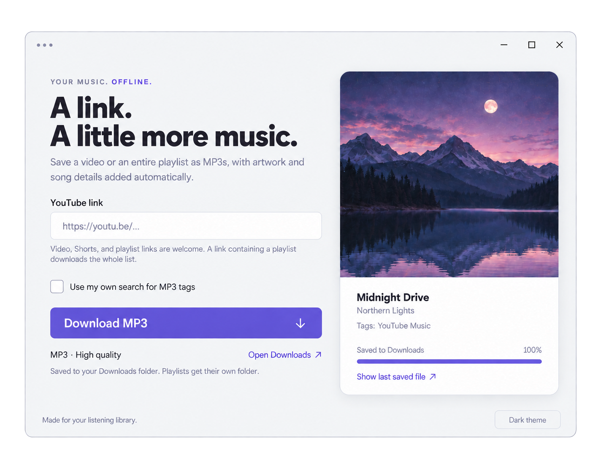

# Youtube to MP3 Downloader

  
  
  

Minimal desktop application that downloads audio from YouTube and saves it as .mp3 to your computer.

- 🎶 downloads MP3 from given YouTube URL
- 💽 can download complete playlist if such URL given
- 🛠 pair it with [our extension](https://github.com/fajicbenjamin/yt2mp3-extension) to download directly from YouTube with one click
- 🎨 automatically tags file with cover art and other tags if available
- 🌗 light and dark themes, download progress, and visible errors for unavailable tracks
- 📁 saves playlists in their own folders and keeps existing files when downloading again

If you already have downloaded a bunch of MP3s that you just want to write tags to, you can use this [project](https://github.com/fajicbenjamin/mp3-metadata-app) instead.

## Download

You can download already packaged releases for Windows or macOS. Here is [latest release](https://github.com/fajicbenjamin/youtube-to-mp3-downloader/releases/latest).

## How to build

If you want to build it yourself, check out [BUILD.md](BUILD.md). Pull requests are welcome!

## License

This project's own source code is licensed under the [MIT License](LICENSE). Third-party dependencies retain their own licenses, including:

- **[yt-dlp](https://github.com/yt-dlp/yt-dlp#licensing):** Bundled standalone executables are GPL-3.0-or-later; yt-dlp's own source is under the Unlicense.
- **[FFmpeg / ffmpeg-static](https://github.com/eugeneware/ffmpeg-static):** `ffmpeg-static` is GPL-3.0-or-later. The FFmpeg executable's license and build notices are included with the app.

Required license texts and third-party notices are included in the application package.
